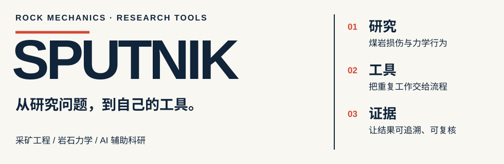

围绕采矿工程与岩石力学开展研究，聚焦水-岩多场耦合与煤岩非均匀损伤演化，同时为自身科研流程构建全链路工具体系。关注实验力学多模态数据、离散元/连续元数值模拟（Itasca PFC/FLAC3D/3DEC），以及 AI 深度辅助科研（多源事实核查、文献深读、无损交接与全流程图件一致性）。

[核心工具体系](#核心工具体系) · [学术研究方向](#学术研究方向) · [工具协同哲学](#工具协同哲学)

## 核心工具体系

从实际科研任务出发，把验证过的最优方法做成可以持续演进、跨机接续的专业工程底座：

| 工具体系 | 核心定位与能力 |
| :--- | :--- |
| **AI Workspace** · 多端协同科研工作空间 | 多机协同的 Agent 规则中枢与 OMP 科研内作系统正典源。内建 cross-verify v3.1 跨端事实核查门禁、抓取交付门静态机检、Obsidian OFM 原生方言规范治理与 Agent 跨会话无损交接机制，统筹 61 项纯血学术与系统治理技能。 |
| **MK / Zotero One** · 文献深读与骨架提取 | 在 Zotero 中连接论文结构化识别、Markdown 原生双链阅读、原文证据可追溯回查与疑点复核，优先复用已有成果构建事实级文献骨架。 |
| **ITASCA MCP & Repos** · 采矿数值模拟底座 | 围绕 PFC、FLAC3D、3DEC、UDEC 离散元/连续元求解器构建原生 WebSocket 桥接与 MCP 接口，并建立 35 个上游数值仿真工具链的行级代码溯源与论文映射档案。 |
| **OCR Benchmark Lab** · 学术文献识别测评 | 中文科研论文 OCR 本地测评档案：原件级对照检查复杂表格、数学公式与排版还原度，客观记录资源成本与持续优化基准。 |
| **lu_color_plot & vivid-illustration** · 科研绘图工作台 | 统一配色规范、实验组名固定色系、版面严谨度检查，以及 108 个学术图表规范配方，确保同一研究与学位论文全景图件的高度一致性与源码可重构性。 |
| **Finance Skills** · 独立金融量化分流池 | 基于奥卡姆剃刀与单一职责原则独立建仓的金融量化、财报前瞻与期权对冲专有技能池，与科研主线彻底物理解耦。 |

*注：以上核心工具以个人科研自用、多端同步与持续精进为主，保持私有维护；在此展示体系全景与架构定位。*

## 学术研究方向

- **煤岩多场耦合与非均匀损伤** · 关注水作用与局部浸水条件下的煤岩损伤集中、微观孔裂隙演化与宏观非线性力学响应。
- **实验观测与数值模拟** · 力学试验、声发射（AE）、数字图像相关（DIC）、工业 CT 观测，结合 PFC2D/3D、FLAC3D、3DEC 开展微裂纹萌生演化与破裂机制模拟。
- **AI 辅助科研与因果核查** · 基于事实先行（Fact-First）原则的文献研判、证据链交叉校核（cross-verify）、原生 Markdown 知识图谱与可追溯学术写作。

## 工具协同哲学

1. **奥卡姆剃刀门槛**：如无必要，勿增实体。技能与工具必须同时满足「边界清晰、高频复现、不可归属」，严禁为偶发任务堆砌实体。
2. **事实先行与物理产物闭环**：模型建议必须保留可追溯的一手核对入口，拒绝表面代理指标，以真实物理产物（退出码、纯 bytes 防冲突落盘、落盘图件）为唯一交付判据。
3. **最小共同约束**：公共仓库维护跨多端协同的最大公约数，单篇论文进度私货回沉具体项目，保持提示词上下文纯度。

---

*这里优先介绍自己维护的核心工具体系与研究方向。Fork 仓库主要用于上游跟踪、文献级模型存档与学习试用，原作者与开源协议归属以各仓库说明为准。*

<details>
<summary>文档维护记录</summary>

```yaml
produced_by: Antigravity & Alma & Lulu
produced_at: 2026-11-17 16:30 +08:00
architecture_version: P6-Final
status: active
```

</details>
